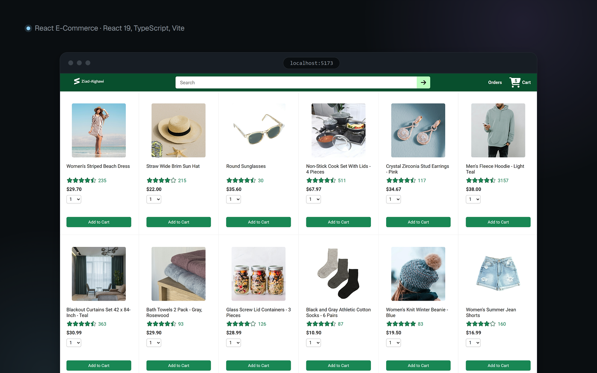

# React E-Commerce Store

A full-stack online store built with React, TypeScript and an Express API, covering the flow from product search to order tracking.

**Live demo:** https://react-ecommerce-8359.onrender.com

> The demo runs on a free server that sleeps when idle, so the first visit may take about a minute to load.



## Features

- Product catalog with search by name or keyword
- Cart with quantity updates and item removal
- Delivery options with a live payment summary
- Order placement and order history, with delivered or arriving status per package
- A separate cart and order history for each visitor, without sign-up, limited to 50 orders each
- Optional accounts with email and password: the cart and orders follow the user to any device, and a guest's cart and orders move to their account when they log in
- Admin page to add, edit and delete products, for the accounts listed in `ADMIN_USER_IDS`
- Package tracking with delivery progress
- Loading, empty and error states, with a retry for failed changes
- Responsive layout for phone and desktop

## Tech Stack

- **Frontend:** React 19, TypeScript, Vite, React Router, Axios, Day.js
- **Backend:** Node.js, Express, Sequelize, Postgres on Supabase (SQLite locally)
- **Accounts:** Supabase Auth, with tokens verified in the API using jose
- **Testing and tooling:** Vitest, Testing Library, Node test runner, ESLint, GitHub Actions

## Run Locally

Requires Node.js 22 or newer.

Install the dependencies:

```bash
npm install
npm --prefix ecommerce-backend install
```

Start the backend on http://localhost:3000. It creates the database and loads the demo data on first run.

```bash
npm run dev:backend
```

In a second terminal, start the frontend on http://localhost:5173:

```bash
npm run dev
```

The dev server forwards API requests to the backend, so no configuration is needed. Optional settings are described in [.env.example](.env.example) and [ecommerce-backend/.env.example](ecommerce-backend/.env.example).

## Database

Locally, the backend keeps its data in a SQLite file, so there's nothing to set up. In production it uses Postgres on Supabase, because the free Render server has no persistent disk: a SQLite file there was wiped on every deploy, restart and sleep, taking every visitor's cart and orders with it.

To use Postgres, set `DATABASE_URL` to a connection string. For Supabase, copy the Session pooler URL from **Connect** in the project dashboard (the direct connection is IPv6 only) and fill in the database password. The server connects over SSL, creates the tables on startup and adds the demo products and delivery options only when those tables are empty, so data survives restarts and deploys.

```bash
cp ecommerce-backend/.env.example ecommerce-backend/.env
# Fill in DATABASE_URL, then:
npm run dev:backend
```

The server reads `ecommerce-backend/.env` on startup, and real environment variables take precedence over it. Restart it after changing the file.

Supabase pauses free projects after a week without activity, so a [GitHub Actions workflow](.github/workflows/keep-alive.yml) loads the products from the live API every 3 days. It can also be run by hand from the Actions tab.

## Accounts

Logging in is optional. Without the settings below, the store runs in guest-only mode: the login is hidden and each browser keeps its own cart, as before.

To turn accounts on, use a Supabase project (it can be the same one as the database):

1. In **Authentication > Sign In / Providers**, enable the Email provider. With **Confirm email** on, new users get a link to confirm their address before they can log in.
2. In **Authentication > URL Configuration**, set the **Site URL** to the store's URL and add it, plus `http://localhost:5173` for local development, to the **Redirect URLs**. The confirmation link comes back to one of these.
3. In **Project Settings > JWT Keys**, make sure the project signs tokens with an asymmetric key (ECC P-256 or RSA, the default for new projects). The API checks tokens against the project's public keys, so it needs no secret.
4. Set the variables. `VITE_` ones are read when the frontend is built, so rebuild after changing them.

| Variable | Where | Value |
| --- | --- | --- |
| `VITE_SUPABASE_URL` | Frontend (`.env.local`) | Project URL, `https://<project-ref>.supabase.co` |
| `VITE_SUPABASE_PUBLISHABLE_KEY` | Frontend (`.env.local`) | Publishable key (`sb_publishable_...`) from **Project Settings > API Keys** |
| `SUPABASE_URL` | Backend (`ecommerce-backend/.env`) | The same Project URL |
| `ADMIN_USER_IDS` | Backend (`ecommerce-backend/.env`) | Optional. User IDs of the admins, comma-separated (see below) |

The publishable key is meant to be public. The secret key and the database password are never needed by the frontend.

When a user is logged in, the frontend sends their access token with each API request. The API verifies it and uses the user ID in place of the visitor ID, so the cart and orders are the same on every device. On the first request after logging in, anything the browser had as a guest moves to the account. An invalid or expired token gets `401`, and the frontend then logs out and carries on as a guest.

### Admins

Admins get an **Admin** link in the header, to a page where they add, edit and delete products. A new product uses one of the store's existing photos and starts without a rating.

To make an account an admin, sign up in the store, then in the Supabase dashboard open **Authentication > Users**, click the user and copy their **User UID**. Put it in `ADMIN_USER_IDS` in the backend's settings (several IDs are separated by commas) and restart the backend.

The API decides who is an admin from the verified token alone, so nothing the browser sends can make a user an admin: admin routes answer `401` without a valid token and `403` for anyone else. The frontend only shows the link when `GET /api/me` says the user is an admin.

Deleting a product hides it rather than removing it: it disappears from the shop and search, but carts and past orders that have it keep working, and the orders page shows it as no longer available.

## Tests

Frontend:

```bash
npm test
npm run lint
npm run build
```

Backend (starts a real server on a free port and calls the API):

```bash
npm --prefix ecommerce-backend test
npm --prefix ecommerce-backend run lint
```

The backend tests use SQLite even when `DATABASE_URL` is set, because they delete data. To run them against Postgres, set `TEST_DATABASE_URL` to a throwaway database. The login tests sign their own tokens and serve the public key from a local stand-in for Supabase, so they need no project either.

GitHub Actions runs all of these on every push.

## Project Structure

```text
.
├── .github/workflows/    # CI pipeline and database keep-alive
├── docs/screenshots/     # README images
├── ecommerce-backend/    # Express API
│   ├── defaultData/      # Demo products and delivery options
│   ├── middleware/       # Visitor ID, login tokens, admin check and async error handling
│   ├── models/           # Sequelize models
│   ├── routes/           # API routes
│   ├── test/             # API tests
│   ├── utils/            # Shared helpers
│   ├── documentation.md  # API reference
│   └── server.js         # Server entry point
├── public/               # Favicon, product photos and rating images
├── src/
│   ├── components/       # Shared components
│   ├── pages/            # Home, checkout, orders, tracking, login, admin
│   ├── hooks/            # Shared hooks
│   ├── types/            # Shared TypeScript types
│   └── utils/            # Helpers and their tests
└── render.yaml           # Render deployment config
```

## Background

This project started from a React course. The backend is based on the [SuperSimpleDev course starter code](https://github.com/SuperSimpleDev/ecommerce-project), and I built the frontend while following the course, then migrated it to TypeScript. Since then I've extended it with a separate cart and orders per visitor, optional accounts with Supabase Auth, an admin page for products, an order limit, loading, empty and error states, input validation, frontend and backend tests, CI and deployment config.

Product photos are from Unsplash and Pexels and credited in [CREDITS.md](public/images/products/CREDITS.md).
